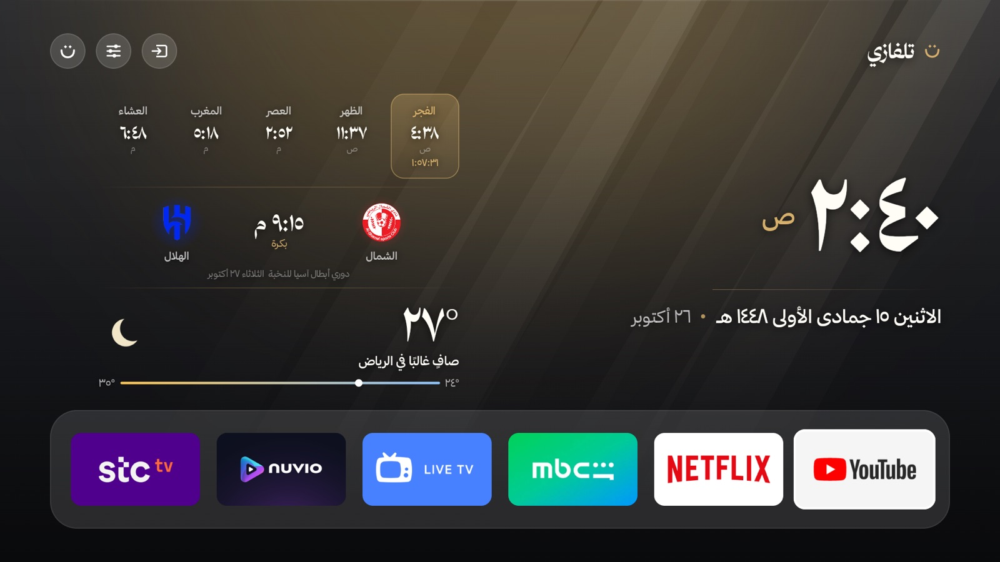
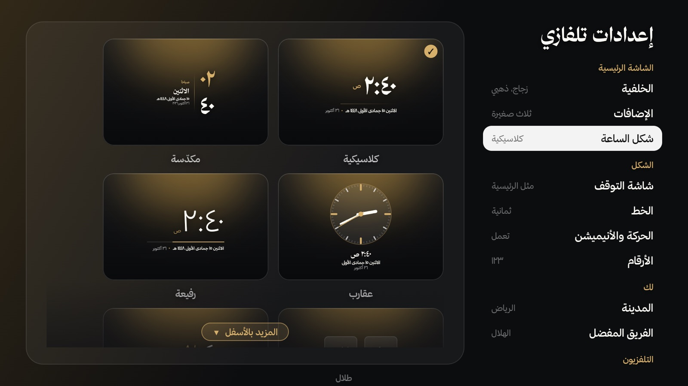
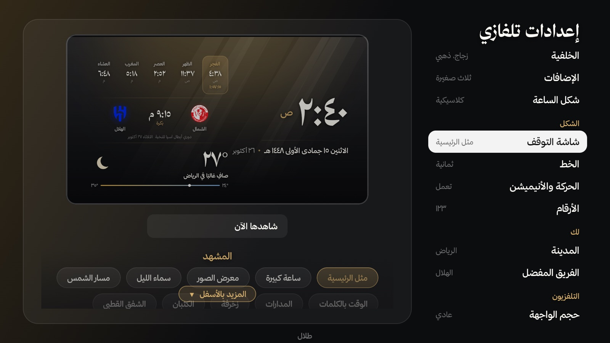
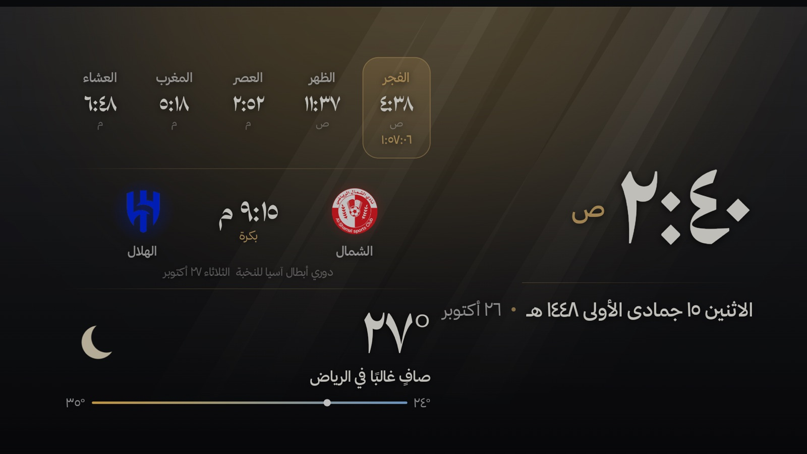
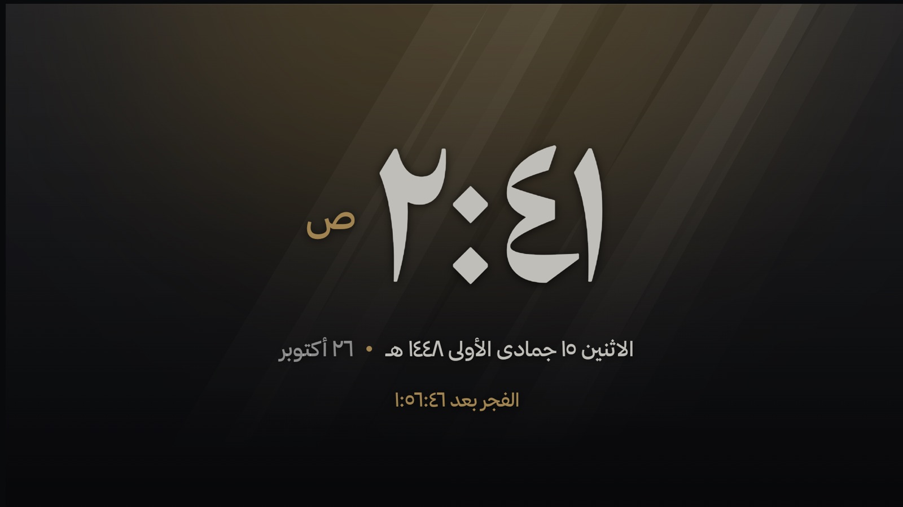
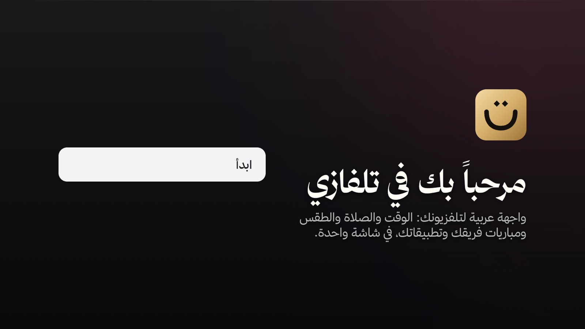
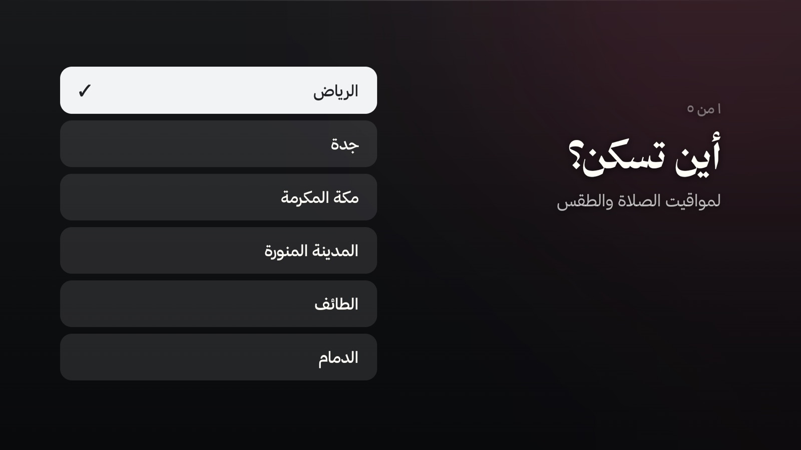

<div dir="rtl">

# تلفازي

**واجهة عربية لتلفزيونات Android TV و Google TV.** الوقت والتاريخ الهجري، ومواقيت الصلاة، والطقس، ومباراة فريقك القادمة، وتطبيقاتك المفضلة: كلها في شاشة واحدة هادئة، بخط عربي جميل، تُقرأ من الكنبة.



## ماذا يقدّم

- **شاشة رئيسية عربية بالكامل** من اليمين إلى اليسار: ساعة كبيرة، التاريخ الهجري والميلادي، وصف المفضلة لتطبيقاتك.
- **مواقيت الصلاة** لمدينتك مع العدّ التنازلي للصلاة القادمة.
- **الطقس** الآن ولبقية اليوم، و**مباراة فريقك** القادمة ونتيجته، والدوري.
- **آية اليوم وحديث اليوم** إن أردت.
- **شاشة توقف** بأكثر من عشرة مشاهد: ساعة كبيرة، معرض صور، سماء الليل، الوقت بالكلمات، وغيرها.
- **إعدادات بسيطة**: القائمة على اليمين، وصفحة الإعداد نفسها تظهر على اليسار، فترى التغيير قبل أن تختاره.
- **تناسب كل شاشة**: من ٣٢ إنش إلى ٨٥ إنش، وشاشات الكمبيوتر بأي نسبة، مع خيار لتكبير الواجهة وآخر لهوامش التلفزيونات التي تقص أطراف الصورة.

<table>
<tr>
<td></td>
<td></td>
</tr>
<tr>
<td align="center">أشكال الساعة، بمعاينة حية</td>
<td align="center">شاشة التوقف ومشاهدها</td>
</tr>
<tr>
<td></td>
<td></td>
</tr>
<tr>
<td align="center">شاشة التوقف «مثل الرئيسية»</td>
<td align="center">شاشة التوقف «ساعة كبيرة»</td>
</tr>
<tr>
<td></td>
<td></td>
</tr>
<tr>
<td align="center">أول تشغيل</td>
<td align="center">تثبيت بسيط وسهل</td>
</tr>
</table>

## التثبيت

طريقتان، اختر الأسهل لك.

### الطريقة الأولى: دع Claude أو Codex يثبّته لك (الأسهل، وتعمل على Google TV)

كل اللي تحتاجه لابتوب على **نفس شبكة الواي فاي** اللي عليها التلفزيون، وعليه **Claude** أو **Codex**. الصق له هذا الطلب:

```text
ثبّت تلفازي على تلفزيوني: اتبع AGENTS.md في https://github.com/TalalRugi/TilfaziTV
```

وهو يكمّل معك خطوة بخطوة: يقولك وين تضغط في التلفزيون لتفعيل وضع المطوّر وتصحيح الأخطاء، ويدوّر على التلفزيون في الشبكة بنفسه، وإذا ما لقاه يسألك ويساعدك. ما تحتاج تكتب أي عنوان ولا أمر.

حين تظهر على التلفزيون رسالة **«السماح بتصحيح الأخطاء؟»** اختر **«السماح دائماً»**. وبعد دقيقة يفتح تلفازي: اختر مدينتك وفريقك، وتفضّل.

### الطريقة الثانية: ملف APK

1. نزّل أحدث ملف `Tilfazi.apk` من صفحة [الإصدارات](../../releases).
2. انقله إلى التلفزيون بالطريقة التي تناسبك:
   - تطبيق **Downloader** على التلفزيون: اكتب فيه رابط الملف.
   - من الجوال بتطبيق **Send Files to TV** أو **LocalSend**.
   - فلاش USB: انسخ الملف إليه، وافتحه على التلفزيون بمدير الملفات.
3. افتح الملف واضغط **«تثبيت»**. إن طلب التلفزيون السماح بالتثبيت من مصادر غير معروفة فاسمح للتطبيق الذي فتحت به الملف.
4. اضغط زر الرئيسية 🏠 في الريموت، واختر **«تلفازي»** ثم **«دائماً»**.

> على **Google TV** (مثل شاومي وTCL الحديثة) لا يظهر اختيار الشاشة الرئيسية في الخطوة ٤؛ استعمل الطريقة الأولى.

### الرجوع إلى شاشة التلفزيون الأصلية

اطلب من Claude أو Codex: «ارجع تلفزيوني كما كان»، وهو يشغّل `install/undo.sh`. يرجع فقط ما أوقفه التثبيت، ويحذف تلفازي.

## الخصوصية

لا حسابات ولا إعلانات ولا تتبّع. يتصل تلفازي بالإنترنت فقط ليجلب الطقس ومواعيد المباريات والصور إن اخترتها، ويحسب مواقيت الصلاة على التلفزيون نفسه.

## الخطوط

الخطوط المضمّنة مرخّصة برخصة [SIL Open Font License](https://openfontlicense.org): مجانية، ويُسمح بتضمينها في التطبيق ونشرها.

---

صُنع بواسطة طلال.

</div>
